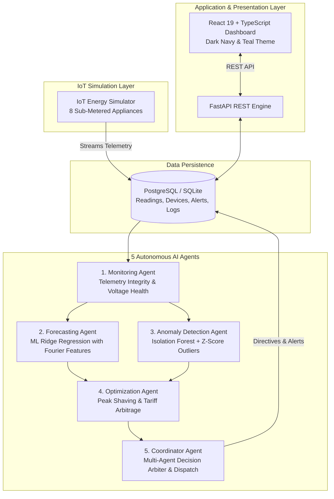

# Multi-Agent AI System for IoT Energy Management

[](https://www.python.org/)
[](https://fastapi.tiangolo.com/)
[](https://react.dev/)
[](https://www.typescriptlang.org/)
[](https://tailwindcss.com/)
[](https://www.postgresql.org/)
[](https://scikit-learn.org/)
[](LICENSE)

> **Monitor • Forecast • Detect • Optimize • Coordinate**  
> *Smarter Energy for a Greener Future*

---

## 🌟 Overview

The **Multi-Agent AI System for IoT Energy Management** is an autonomous full-stack platform built for smart buildings and residential micro-grids. It coordinates five independent, specialized Python AI agents to monitor electrical telemetry, predict future energy demand, detect power surges and appliance faults, recommend cost-saving curtailment actions, and arbitrate grid-level decisions in real time.

The system includes a **physics-grounded IoT simulation engine** streaming realistic high-frequency telemetry for **8 smart appliances**, complete with time-of-day diurnal curves, voltage fluctuations, reactive power, and an interactive **anomaly injection playground**.

---

## 🏗️ System Architecture



---

## 🤖 The Five Autonomous AI Agents

| # | Agent Name | Core Machine Learning & Algorithmic Technique | Responsibility |
|---|---|---|---|
| **1** | **Monitoring Agent** | Range validation, power factor tracking, null interpolation | Ingests raw telemetry, validates 230V bus bounds, and computes a 0-100% **Sensor Health Score**. |
| **2** | **Forecasting Agent** | **Ridge Regression** with trigonometric Fourier harmonic encoding ($\sin, \cos$) | Predicts next 24-hour demand curve (kW) with **95% Confidence Bounds** ($\pm 1.96\sigma$) and 7-day totals. |
| **3** | **Anomaly Detection Agent** | **Isolation Forest** (`contamination=0.05`) + Statistical Z-Score ($\|Z\| > 2.5$) | Identifies compressor overload, voltage sags, continuous heater leaks, and phantom drain; dispatches classified `Alert` records. |
| **4** | **Optimization Agent** | Time-of-Use (TOU) tariff arbitrage ($0.28 peak vs $0.12 off-peak) | Recommends load-shifting for flexible devices, AC eco setpoint adjustment, and standby vampire power cut with quantified kWh and $ savings. |
| **5** | **Coordinator Agent** | Multi-Agent Arbitration & Decision Tree Dispatch | Synthesizes all 4 sub-agent findings, prioritizes safety over routine savings, calculates the **Grid Stability Index**, and assigns a System Grade (**A+ to F**). |

---

## ⚡ The 8 Simulated IoT Appliances

The built-in physics simulator generates voltage ($V$), active power ($W$), current ($A$), and power factor ($PF$) based on realistic diurnal usage profiles:

1. **Living Room AC** (1500W rated) — Daytime/evening cooling curves; target for thermal setpoint optimization.
2. **Kitchen Refrigerator** (300W rated) — Continuous cycling compressor; marked **Critical Priority (P1)** (cannot be remotely disconnected).
3. **Washing Machine** (1200W rated) — Periodic spin-cycle loads; marked **Flexible Priority (P3)** (ideal for peak shaving).
4. **Water Heater (Geyser)** (2000W rated) — Morning/evening peak heating draw; marked **Flexible Priority (P3)**.
5. **Smart TV & Soundbar** (200W rated) — Prime evening entertainment draw; targeted for nighttime vampire cut.
6. **Home Office Lighting** (100W rated) — Ambient lighting active during morning/evening.
7. **Workstation Laptop & Monitors** (65W rated) — Daytime productivity load.
8. **Kitchen Microwave** (1000W rated) — Short, high-power bursts during meal prep.

### 🧪 Anomaly Injection Playground
Via the floating simulator control bar or API, you can trigger:
- `AC_OVERLOAD`: Simulates compressor failure drawing 3,150W (+110% over capacity) with power factor drop to 0.62.
- `HEATER_RUNAWAY`: Simulates a stuck thermostat drawing 2,700W continuously.
- `VOLTAGE_SAG`: Drops bus voltage to 192V (below the 211.6V safety threshold).
- `PHANTOM_DRAIN`: Injects 350W of continuous unmetered parasitic drain.

---

## 🚀 Quickstart Guide

### Option 1: Local Development (Recommended)

#### Prerequisites
- **Python 3.10+** (Python 3.13 supported)
- **Node.js 18+** & **npm**

#### 1. Start Backend
```bash
cd backend

# Install dependencies
python -m pip install -r requirements.txt

# Run server (tables are auto-created and pre-seeded with 7 days of data!)
python -m uvicorn app.main:app --host 127.0.0.1 --port 8000 --reload
```
*Backend Swagger Docs will be available at: http://127.0.0.1:8000/docs*

#### 2. Start Frontend
```bash
cd frontend

# Install dependencies
npm install

# Start Vite dev server
npm run dev
```
*Frontend Dashboard will be live at: http://localhost:3000 (or the port indicated by Vite)*

---

### Option 2: Docker Compose (Full Stack)

```bash
docker-compose up --build
```
This spins up:
- **Database**: PostgreSQL 16 on port `5432`
- **Backend API**: FastAPI on port `8000`
- **Frontend SPA**: Nginx + React on port `3000`

---

## 📊 Dashboard Views (10 Integrated Interfaces)

1. **Overview**: Executive cockpit with 4 KPI cards (Total Consumption, Current Demand, Cost Today, Health Score), 24h demand area chart, device breakdown donut chart, active alerts list, and priority recommendations.
2. **Live Monitoring**: Real-time telemetry feed updating every 2.0s with live wattmeters, bus voltage, current, power factor, oscilloscope sparklines, and device remote power switches.
3. **Devices**: Appliance table with room locations, rated watts, live telemetry, priority tags, search/room filters, and **Add Appliance** modal form.
4. **Analytics**: 24-hour bar chart comparing Peak Tariff hours ($0.28/kWh) vs Off-Peak hours ($0.12/kWh), carbon footprint accounting ($0.42\text{ kg CO}_2/\text{kWh}$), and peak load metrics.
5. **Forecasts**: 24-hour forward load prediction with shaded **95% Confidence Interval band** ($\pm 1.96\sigma$), peak hour prediction badge, and weekly total projections.
6. **Anomaly Alerts**: Alert feed with severity badges (`CRITICAL`, `WARNING`, `INFO`), root cause analysis, measured vs threshold comparison, and one-click **Resolve** buttons.
7. **Optimization**: Concrete energy-saving action cards (Peak Shaving, Thermostat Setpoint, Vampire Load Cut) with calculated kWh and $ savings, and instant **Apply Action** buttons.
8. **AI Agents**: Interactive multi-agent orchestration architecture! Shows status, duration, and summaries for all 5 agents, manual trigger buttons, and a **live terminal audit log**.
9. **Reports**: Formal Energy Efficiency Audit Report with grade badge (**A+ to F**), historical summary, and **Download JSON** / **Export CSV** telemetry buttons.
10. **Settings**: Time-of-Use tariff rate editor, grid capacity limit (kW), and ML Isolation Forest sensitivity slider.

---

## 🧪 Testing & Verification

### Run Backend Unit & Integration Tests (17/17 Passed)
```bash
cd backend
python -m pytest tests -v
```
**Test Suite Coverage:**
- `test_agents.py`: Unit tests for Monitoring, Forecasting, Anomaly, Optimization, and Coordinator agents.
- `test_simulator.py`: Physical electrical relations ($I = P / (V \cdot PF)$), appliance ON/OFF state transitions, and anomaly injection.
- `test_api.py`: FastAPI endpoint responses, device power toggling, analytics KPIs, and coordinator workflow.

### Run Frontend TypeScript Compilation & Production Build
```bash
cd frontend
npm run build
```
Compiles TypeScript with zero errors and outputs production assets to `dist/`.

---

## 📡 REST API Reference

| Method | Endpoint | Description |
|---|---|---|
| `GET` | `/` | API status and metadata |
| `GET` | `/api/devices` | List all 8 appliances with current telemetry |
| `POST` | `/api/devices/{id}/toggle` | Remote power switch toggle (ON/OFF) |
| `POST` | `/api/devices` | Register a new sub-metered appliance |
| `GET` | `/api/readings/latest` | Most recent telemetry per appliance |
| `GET` | `/api/readings/live-aggregate` | Whole-system active power, voltage, current, PF |
| `GET` | `/api/readings/history` | Historical telemetry time-series query |
| `GET` | `/api/analytics/kpi` | Key performance indicators (Total kWh, Cost $, Health %) |
| `GET` | `/api/analytics/hourly-trend` | 24-hour demand by tariff window |
| `GET` | `/api/analytics/device-breakdown` | Energy percentage share per device |
| `GET` | `/api/forecasts/24h` | ML Ridge regression 24-hour forecast with 95% CI |
| `GET` | `/api/anomalies` | Detected anomalies with severity & resolution filters |
| `POST` | `/api/anomalies/{id}/resolve` | Acknowledge and resolve an active anomaly alert |
| `GET` | `/api/optimizations` | Energy savings and load curtailment recommendations |
| `POST` | `/api/optimizations/{id}/apply` | Execute recommended action and update device state |
| `POST` | `/api/agents/run-coordinator` | Execute the master multi-agent orchestration cycle |
| `POST` | `/api/agents/run/{agent_name}` | Trigger an individual agent |
| `GET` | `/api/agents/status` | Current status and summary of all 5 agents |
| `GET` | `/api/agents/history` | Multi-agent execution terminal audit log |
| `GET` | `/api/simulator/status` | Simulator state, tick count, active anomaly |
| `POST` | `/api/simulator/toggle` | Pause or resume background simulation |
| `POST` | `/api/simulator/inject-anomaly` | Inject power overload, voltage sag, or phantom drain |
| `POST` | `/api/simulator/clear-anomaly` | Clear active injected anomaly |
| `GET` | `/api/reports/summary` | Energy efficiency audit summary & grade |
| `GET` | `/api/reports/export` | Download complete telemetry dataset as CSV |

---

## 📄 License
This project is licensed under the MIT License.
