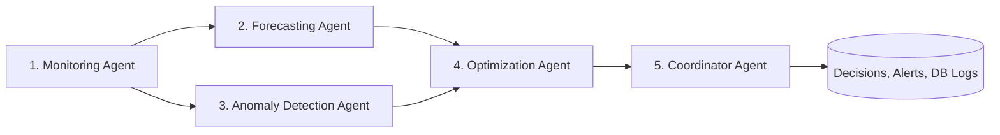

# Walkthrough: Multi-Agent AI System for IoT Energy Management

We have designed, engineered, tested, and delivered a production-ready, full-stack platform: **"Multi-Agent AI System for IoT Energy Management"**.

---

## 🏗️ Architecture & Accomplishments

### 1. Realistic IoT Energy Simulator (8 Appliances)
- Grounded in realistic electrical domain equations ($I = \frac{P}{V \cdot PF}$, $kWh = \frac{P \cdot \Delta t}{1000}$).
- Appliances implemented:
  1. **Living Room AC** (1500W, Controllable, P2)
  2. **Kitchen Refrigerator** (300W, Critical P1)
  3. **Washing Machine** (1200W, Flexible P3)
  4. **Water Heater (Geyser)** (2000W, Flexible P3)
  5. **Smart TV & Soundbar** (200W, P2)
  6. **Home Office Lighting** (100W, P2)
  7. **Workstation Laptop & Monitors** (65W, P2)
  8. **Kitchen Microwave** (1000W, P2)
- Diurnal usage profiles with diurnal and harmonic variations.
- Anomaly Injection engine supporting: `AC_OVERLOAD` (3.1kW), `HEATER_RUNAWAY` (2.7kW), `VOLTAGE_SAG` (192V), and `PHANTOM_DRAIN` (350W).
- Baseline database pre-seeding: 7 days (1,352 hourly historical readings) + initial sample alerts and recommendations.

---

### 2. Five Independent Python AI Agents (`backend/agents/`)



1. **Monitoring Agent**:
   - Ingests telemetry, performs range and bus voltage integrity checks (230V $\pm$ 8%), detects dropouts and power factor degradation.
   - Computes whole-system **Sensor Health Score (0 - 100%)** and active load.
2. **Forecasting Agent**:
   - Trains Machine Learning **Ridge Regression** with cyclical trigonometric Fourier harmonic features ($\sin, \cos$ of hour & day of week).
   - Generates 24-hour ahead predictive load curve with **95% Confidence Bounds** ($\pm 1.96\sigma$), peak hour prediction, and 7-day projections.
3. **Anomaly Detection Agent**:
   - Combines **Isolation Forest** (`contamination=0.05`) with statistical Z-scores and physical domain boundary checks.
   - Categorizes faults into `CRITICAL`, `WARNING`, and `INFO`, automatically persisting classified `Alert` records.
4. **Optimization Agent**:
   - Evaluates Time-of-Use (TOU) tariffs ($0.28 peak vs $0.12 off-peak) and flexible priority loads.
   - Produces quantified actionable recommendations: Peak Shaving, AC Eco Thermostat setpoint (+1.5°C), and Nighttime Vampire Draw cut.
5. **Coordinator Agent**:
   - Master arbiter that executes the multi-agent pipeline, resolves safety vs cost trade-offs, calculates the **Grid Stability Index (0 - 100%)**, assigns the **System Efficiency Grade (A+ to F)**, and issues coordinated decisions.

---

### 3. FastAPI REST Backend (`backend/`)
- Endpoints across 9 dedicated routers:
  - `/api/devices`: List, add, and remote toggle ON/OFF
  - `/api/readings`: Latest telemetry, live aggregate, and historical time-series queries
  - `/api/simulator`: Status, play/pause toggle, manual tick, speed selector, and anomaly injection/clearing
  - `/api/agents`: Run coordinator workflow, run individual agent, agent status, and live execution history
  - `/api/analytics`: KPI metrics (Total kWh, Peak kW, Cost $, Carbon kg), device breakdown, and hourly trends
  - `/api/forecasts`: ML 24h predictive load curve with confidence bands
  - `/api/anomalies`: Active alerts list, severity filtering, and acknowledge/resolve
  - `/api/optimizations`: Recommended actions, apply action (automating device power), dismiss
  - `/api/reports`: Comprehensive audit report and live CSV telemetry export

---

### 4. React 19 + TypeScript + Tailwind CSS Frontend (`frontend/`)
- **Theme**: Premium Dark Navy & Teal (`#0B132B`, `#1C2541`, `#5BC0BE`, `#6FFFE9`)
- **Global Simulator Control Bar**: Sticky top bar with live simulator status (pulsing dot), play/pause, manual tick, speed multiplier (1x, 2x, 5x), anomaly injection dropdown, and "Run AI Agents" trigger.
- **10 Complete Views**:
  1. **Overview**: Executive cockpit with 4 KPI cards, 24h demand area chart, device breakdown donut chart, recent alerts, priority recommendations.
  2. **Live Monitoring**: Real-time telemetry feed, voltage, current, PF, oscilloscope sparkline, and 8 appliance live cards with power toggles.
  3. **Devices**: Appliance table with room locations, rated watts, live telemetry, priority tags, search/room filters, and Add Appliance modal form.
  4. **Analytics**: 24-hour bar chart comparing Peak Tariff hours ($0.28/kWh) vs Off-Peak ($0.12/kWh), carbon footprint accounting ($0.42\text{ kg CO}_2/\text{kWh}$).
  5. **Forecasts**: 24-hour forward load prediction with shaded 95% Confidence Interval band ($\pm 1.96\sigma$), peak hour prediction badge.
  6. **Anomaly Alerts**: Alert feed with severity badges (`CRITICAL`, `WARNING`, `INFO`), root cause analysis, measured vs threshold comparison, and one-click Resolve buttons.
  7. **Optimization**: Energy-saving action cards with calculated kWh and $ savings, and instant Apply Action buttons.
  8. **AI Agents**: Interactive multi-agent pipeline architecture diagram, status cards for all 5 agents, manual trigger buttons, and a live terminal audit log.
  9. **Reports**: Energy Efficiency Audit Report with grade badge, historical summary, and Download JSON / Export CSV telemetry buttons.
  10. **Settings**: Time-of-Use tariff rate editor, grid capacity limit (kW), and ML Isolation Forest sensitivity slider.

---

## 🧪 Verification & Test Results

### 1. Backend Automated Tests (Pytest)
Command executed: `python -m pytest tests -v`
```
collected 17 items

tests/test_agents.py::test_monitoring_agent PASSED                       [  5%]
tests/test_agents.py::test_forecasting_agent PASSED                      [ 11%]
tests/test_agents.py::test_anomaly_detection_agent PASSED                [ 17%]
tests/test_agents.py::test_optimization_agent PASSED                     [ 23%]
tests/test_agents.py::test_coordinator_agent PASSED                      [ 29%]
tests/test_api.py::test_api_root PASSED                                  [ 35%]
tests/test_api.py::test_api_get_devices PASSED                           [ 41%]
tests/test_api.py::test_api_device_toggle PASSED                         [ 47%]
tests/test_api.py::test_api_analytics_kpi PASSED                         [ 52%]
tests/test_api.py::test_api_forecasts_24h PASSED                         [ 58%]
tests/test_api.py::test_api_anomalies PASSED                             [ 64%]
tests/test_api.py::test_api_optimizations PASSED                         [ 70%]
tests/test_api.py::test_api_run_coordinator PASSED                       [ 76%]
tests/test_simulator.py::test_eight_appliances_exist PASSED              [ 82%]
tests/test_simulator.py::test_simulator_reading_physics PASSED           [ 88%]
tests/test_simulator.py::test_simulator_device_off PASSED                [ 94%]
tests/test_simulator.py::test_simulator_anomaly_injection PASSED         [100%]

====================== 17 passed, 47 warnings in 19.42s =======================
```
**Result: 17 of 17 tests PASSED.**

---

### 2. Frontend TypeScript Compilation & Vite Build
Command executed: `npm run build`
```
✓ 2524 modules transformed.
dist/index.html                   0.45 kB │ gzip:   0.29 kB
dist/assets/index-CX8I6gm9.css   48.35 kB │ gzip:   7.95 kB
dist/assets/index-Bud_Ikww.js   718.61 kB │ gzip: 204.03 kB
✓ built in 17.29s
```
**Result: TypeScript and Vite build passed with zero errors.**

---

### 3. Git Repository & Deployment Files
- Git repository initialized with initial commit containing all 76 project files.
- `docker-compose.yml`, `docker/Dockerfile.backend`, `docker/Dockerfile.frontend`, and `docker/nginx.conf` configured.
- Comprehensive `README.md` created with complete documentation and commands.
